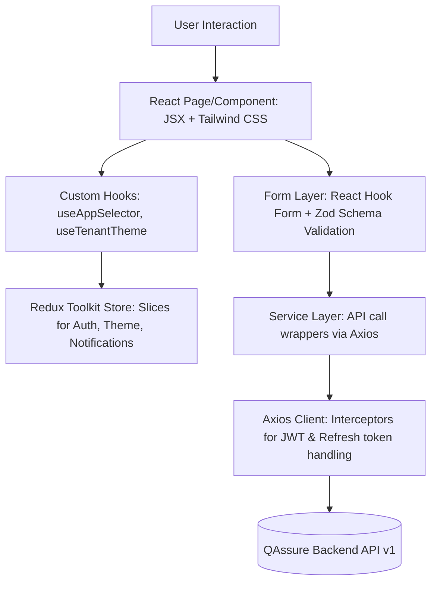

# Frontend Source File Structure

This document provides a comprehensive overview of the QAssure Frontend codebase structure, architectural layers, directory mapping, and design patterns.

---

## 1. Architectural Overview

The QAssure frontend is built as a Single Page Application (SPA) using **React (v19), TypeScript, Vite, Tailwind CSS, and Redux Toolkit**. The architecture follows a modular, feature-oriented structure with strict separation between UI rendering and API communication:



---

## 2. Directory Layout & Key Components

Below is the directory map of the frontend project with the purpose of each directory:

```
qassure-frontend/
├── .env                          # Configuration variables (VITE_API_BASE_URL)
├── .env.example                  # Template configuration variables
├── index.html                    # Root HTML entry point
├── package.json                  # Frontend dependencies and run scripts
├── tsconfig.json                 # TypeScript compiler base settings
├── vite.config.ts                # Vite build and plugin configurations (Tailwind CSS, React, path aliases)
├── tailwind.config.js / css      # Tailwind styling presets and directives
│
├── public/                       # Static public assets (icons, images, manifest)
│
├── src/                          # Main source code folder
│   ├── App.tsx                   # Main React entry component wrapping Providers (Redux, Router)
│   ├── main.tsx                  # ReactDOM bootstrapper mounting App to DOM
│   ├── index.css                 # Global CSS styles and Tailwind base configurations
│   │
│   ├── assets/                   # Local media assets (logos, svg icons, branding graphics)
│   ├── auth/                     # Session tracking helpers, contexts, or legacy providers
│   │
│   ├── components/               # Reusable UI components
│   │   ├── layout/               # Shell components: Sidebar, Header, Page Layout definitions
│   │   ├── shared/               # Global standard components: Button, Modal, Table, StatusBadge
│   │   ├── superadmin/           # Components scoped specifically for Super Admin dashboard views
│   │   ├── tenant/               # Components scoped specifically for Tenant users dashboard views
│   │   └── ui/                   # Primitive custom form inputs, sliders, and design elements
│   │
│   ├── constants/                # Immutable global configuration values, states, and text mappings
│   ├── features/                 # State slices or business-feature specific logic
│   ├── hooks/                    # Custom global React hooks (Redux shortcuts, theme listeners)
│   ├── lib/                      # Configuration and initialization files for libraries
│   │
│   ├── pages/                    # Routed page views (containers containing page state)
│   │   ├── superadmin/           # Views accessible to Super Admins (Storage Configs, Module Masters)
│   │   ├── tenant/               # Views accessible to Tenant Admins/Users (Settings, Documents, Tasks)
│   │   ├── Login.tsx             # Super Admin login landing view
│   │   ├── TenantLogin.tsx       # Tenant-specific portal login view
│   │   ├── ProtectedRoute.tsx    # Higher-Order Component protecting Super Admin routes
│   │   └── NotFound.tsx          # 404 fallback page
│   │
│   ├── routes/                   # Routing configuration definitions
│   │   ├── index.tsx             # Core Router provider mounting routes and lazy loading modules
│   │   ├── public-routes.tsx     # Paths accessible without authentication
│   │   ├── super-admin-routes.tsx# Navigation routes for Super Admins
│   │   └── tenant-admin-routes.tsx# Navigation routes for Tenant Admins
│   │
│   ├── services/                 # API client configurations and API request services
│   │   ├── api-client.ts         # Central Axios client with token injection & automated token-refresh loop
│   │   ├── storage-bucket-service.ts # Storage bucket CRUD and tenant assignment services
│   │   └── ...and more services  # Services mapping to backend endpoints
│   │
│   ├── store/                    # Redux Toolkit global store configuration
│   │   ├── store.ts              # Redux store instantiation with persisting logic (Redux Persist)
│   │   ├── authSlice.ts          # State slice for user session, access/refresh tokens, and roles
│   │   ├── themeSlice.ts         # State slice for dark/light modes and dynamic tenant branding themes
│   │   └── notificationSlice.ts  # State slice for central notifications and unread badges
│   │
│   ├── styles/                   # Modular style components, custom css overrides
│   ├── types/                    # Unified TypeScript interface declarations matching backend models
│   └── utils/                    # Global utility methods: formatters, token decoders, and validation rules
│
└── docs/                         # Developer manuals and deployment context documentation
```

---

## 3. Key Core Modules & Configurations

### 3.1 Routing & Security Boundary
*   **`src/routes/`**: Handles application URL navigation. Uses React Router DOM's lazy-loading component approach to split bundles dynamically.
*   **`ProtectedRoute.tsx` & `TenantProtectedRoute.tsx`**: Guards routes. Intercepts navigation attempts, reads the user session state from the Redux store, redirects unauthorized requests to appropriate login portals, and manages role validation.

### 3.2 Global State Management
*   **`src/store/`**: Runs Redux Toolkit.
    *   `authSlice.ts` maintains user credentials, authorization status, and roles.
    *   `themeSlice.ts` manages style definitions. It supports tenant-specific dynamic theming, parsing primary and secondary hex codes retrieved on tenant login, and injecting them into HTML styling variables.
    *   `store.ts` wraps slices inside `redux-persist` so that user auth states are saved in localStorage and survived through browser page reloads.

### 3.3 Network Communication Layer
*   **`src/services/api-client.ts`**: The central network connector. It provides:
    1.  **Authorization Interceptor**: Dynamically grabs the active JWT token from the Redux store on every outgoing request and injects it as an `Authorization: Bearer <token>` header.
    2.  **Automated Refresh Token Interceptor**: Monitors response streams. If a request fails with an HTTP `401 Unauthorized` status (due to token expiration), the client freezes the request queue, invokes the `/auth/refresh` API to fetch new tokens, dispatches them to the Redux store, and automatically retries the frozen requests.

### 3.4 Form & Input Validation
*   **`src/components/ui/` & `src/validation/`**: Inputs are handled using **React Hook Form**. Validations are defined using **Zod schema validations** matching backend constraints. Resolvers bind Zod constraints directly to form schemas, displaying real-time frontend field errors to the user before submitting.

---

## 4. Coding & UX Standards

1.  **Component Architecture**: Always split large view files into reusable sub-components in the same directory, or place them under `src/components/shared/` if they are utilized by multiple domains.
2.  **Type Safety**: Define TypeScript types inside `src/types/` for all network response structures and component parameters. Avoid using `any`.
3.  **Strict Styling Isolation**: Do not use ad-hoc style sheets or inline CSS for spacing. Apply standard Tailwind classes. Dynamic properties like branding themes must be styled using Tailwind's CSS variable mapping.
4.  **No Direct Axios Calls**: Never trigger direct `axios.get` or `axios.post` in page views. All API communication must be funneled through dedicated service files located in `src/services/` to keep page logic decoupled.
